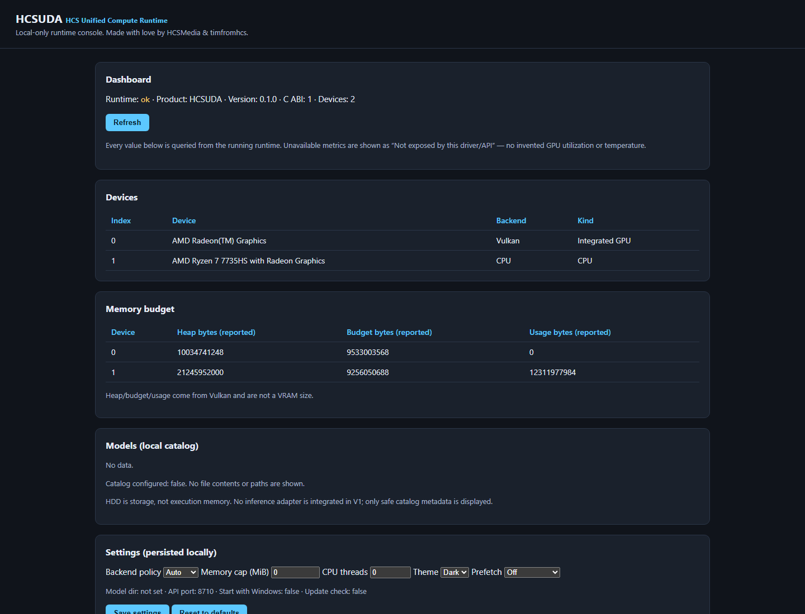

# HCSUDA

[](https://github.com/timfromhcs/HCSUDA/actions/workflows/ci.yml)
[](https://github.com/timfromhcs/HCSUDA/releases/tag/v0.1.0-rc.2)
[](https://hcsuda-webgpu-demo-mhm11twi4-hcsmediacorp.vercel.app)
[](LICENSE)

**Repository:** <https://github.com/timfromhcs/HCSUDA>

**HCS Unified Compute Runtime** — a Vulkan-based, cross-vendor GPU compute runtime with a
portable C ABI, a CPU reference backend, and an expanding CUDA-source migration path.

> **Status: 0.1.0 release candidate.** Local: single-file EXE, checksum and SBOM on the
> [`v0.1.0-rc.2`](https://github.com/timfromhcs/HCSUDA/releases/tag/v0.1.0-rc.2) GitHub release.
> Cloud: a clearly scoped [WebGPU/WASM browser demo](https://hcsuda-webgpu-demo-mhm11twi4-hcsmediacorp.vercel.app)
> is deployed on Vercel. Waves 0–13 are implemented; 96/96 tests, 8/8 hosted CI jobs, a 60-minute
> soak (1418 iterations, 0 failures) and all release gates are green. Runtime, kernels,
> HCSIR/HCSCC, CUDA-source migration subset, model catalog, local REST/MCP with browser UI and a
> single-file installer are tested on Radeon 680M (Vulkan 1.4.315) and CPU. GGUF inference, PTX
> import and a native Qt/WebView2 shell are out of V1 scope. Evidence: `docs/TEST_MATRIX.md`;
> remaining owner actions: `docs/release/EXTERNAL_BLOCKERS.md`.

HCSUDA is an independent project. It is **not** affiliated with, endorsed by, or sponsored by
NVIDIA Corporation. "CUDA" is a trademark of NVIDIA and appears here only to describe
migration tooling.

---



*Real V1 console captured from `http://127.0.0.1:8712/ui/` with the live Radeon 680M runtime;
unavailable GPU metrics are explicitly marked rather than invented.*

## What works today

| Capability | Status | Evidence |
|---|---|---|
| Runtime init/shutdown, stable C ABI (v1) | **Native / Stable** | `tests/unit/test_api.cpp` |
| Device enumeration: Vulkan + CPU | **Native / Stable** | `hcsdoctor` on Radeon 680M |
| Capability reporting (workgroups, subgroup, memory budget) | **Supported via Vulkan** | `hcsdoctor`, `vulkaninfo` cross-check |
| FP16 / INT8 / matrix claims | **Not claimed** unless the queried feature exists | capability bits |
| Buffer create/upload/download/clear | **Native / Stable** | unit + integration tests |
| Compute dispatch: vector add, scale, two-stage reduce, FP32 matmul, global scan pipeline, transpose, 256-bin histogram | **Native / Stable** | CPU + Vulkan tests, KC-01..12 |
| CPU backend (scalar + runtime AVX2/FMA) | **Native / Stable** | `cpu_*` tests |
| Memory cap and clean OOM error | **Native / Stable** | `vulkan_memory_cap_is_enforced` |
| Bounded on-disk Vulkan pipeline cache (device-fingerprinted, corruption-safe) | **Native / Stable** | `vulkan_pipeline_cache_persists_across_contexts` (VK-06) |
| HCSFlow async submit + hcsFlowSynchronize, HEvent flow marker | **Native / Stable** | FL-01..FL-05 |
| Diagnostics CLI (`hcsdoctor`) | **Native / Stable** | this repo |
| Benchmarks (`hcsbench`) | **Native / Stable** | `benchmarks/baselines/` |
| HCSIR v1 parser/verifier + CPU interpreter + HCSCC GLSL lowering → Vulkan execution | **Experimental** | `ir_*` tests, IR-18 GPU run, `docs/api/hcsir.md` |
| CUDA source scan + narrow vecadd translation (`hcsport`) | **Experimental** | PORT-01..03, TR-01..03, `docs/api/hcsport.md` |
| Model vault catalog (SHA-256, path allowlist, storage only); GGUF inference out of V1 scope | **Experimental** | MV-01..04, `docs/api/model-vault.md` |
| Local-only REST with token auth, rate limit and safe model listing + MCP stdio (5 read-only tools) | **Experimental** | REST-01..07, MCP-01..07, `docs/api/openapi.json` |
| Local browser UI (Dashboard, Devices, Memory, Models, Settings, About, Compatibility) | **Experimental** | UI-01..05, SET-01..05, served at `http://127.0.0.1:<port>/ui/` |
| One-file native EXE installer (unsigned, SHA-256 published) | **Experimental** | INS-01..04, `docs/release/installer.md` |

### Roadmap (not in V1, no feature claimed today)

* GGUF inference adapter with a tested Vulkan backend and published quantisation support.
* Textual PTX importer for a verified opcode subset; CUBIN/SASS translation remains unsupported.
* Native Qt/WebView2 desktop shell (ADR-0003 currently selects the local browser console).
* Streamable HTTP MCP transport with localhost-only authentication and Origin validation.
* Additional UI sections: Translate, Benchmarks, Visualizer, API/MCP, Diagnostics.
* Device-local allocation with staging, GPU timestamp queries and allocator pooling.
* Multi-GPU scheduling and selected CUDA Runtime ABI compatibility behind an opt-in launcher.

These items are **not** shipped in this release candidate. See `docs/release/v1-scope.md` and
`docs/KNOWN_LIMITATIONS.md`.

## Compatibility matrix

| Area | Status | Detail |
|---|---|---|
| Vulkan GPU compute | **Supported via Vulkan** | Requires a vendor Vulkan 1.0+ ICD with a compute queue; every capability is queried at runtime, never assumed |
| Reference GPU | **Tested** | AMD Radeon 680M (RDNA 2, UMA), Vulkan 1.4.315, driver 32.0.21043.12001 |
| Other Vulkan GPUs | **Capability-dependent, not verified here** | Intel/NVIDIA devices were not available on the test machine; cross-vendor claims are not made |
| CPU fallback | **Native / Stable** | Scalar + runtime-gated AVX2/FMA; works without any Vulkan driver |
| FP16 / BF16 / INT8 / matrix | **Not claimed** | No tested feature gate or kernel in V1 |
| CUDA source | **Translated subset** | One documented vecadd shape; unsupported constructs fail closed |
| PTX text / CUBIN / SASS | **Unsupported** | No importer and no NVIDIA binary execution on AMD hardware |
| GGUF inference | **Out of V1 scope** | Model catalog stores and hashes; every model reports `runnable: false` |

## What HCSUDA is not

* Not a GPU kernel-mode driver. It never installs, replaces, or patches an AMD/Intel/NVIDIA
  display driver, `vulkan-1.dll`, or the Windows Driver Store.
* Not a universal CUDA emulator. NVIDIA CUBIN/SASS binaries cannot execute on AMD hardware.
* Not a drop-in `nvcuda.dll` replacement.
* Not a claim that every Vulkan GPU supports every precision or AI model.
* Not a claim that the GPU is always faster than the CPU.

## Requirements

* Windows 11 x64 (tested: Windows 11 Pro 10.0.26200).
* A vendor GPU driver with a Vulkan 1.0+ ICD for GPU execution. If Vulkan is unavailable the
  CPU backend still runs.
* Build only: Visual Studio 2022 Build Tools (MSVC 14.4x), CMake >= 3.28, Ninja optional,
  Vulkan SDK (headers + `glslc`). None of these are required on end-user machines.

## Build from source (verified)

```powershell
cmake --preset windows-tests
cmake --build --preset windows-tests --parallel
ctest --preset windows-tests --output-on-failure

# Validation-layer profile (requires VK_LAYER_KHRONOS_validation from the Vulkan SDK)
cmake --preset windows-validation
cmake --build --preset windows-validation --parallel
ctest --preset windows-validation --timeout 180 --output-on-failure

# CPU-only build and tests (no Vulkan SDK required)
cmake --preset windows-cpu-only
cmake --build --preset windows-cpu-only --parallel
ctest --preset windows-cpu-only --output-on-failure
```

Outputs land in `build/<preset>/RelWithDebInfo/`:

* `hcsdoctor.exe` — device, capability and memory-budget report (`--json` supported)
* `hcsbench.exe` — reproducible micro-benchmarks (`--json`, `--device`, `--reps`, `--cache-dir`)
* `hcscc.exe` — HCSIR v1 → GLSL 450 compute shader (`--input`, `--output`, `--stats`)
* `hcsport.exe` — CUDA source compatibility scan (`--scan <file.cu> [--json]`) and narrow,
  conformance-tested vecadd translation (`--convert <file.cu> [--output out.hcsir]`)
* `hcs_tests.exe` — unit/integration suite

## Quick start: run the tools

```powershell
build\windows-tests\RelWithDebInfo\hcsdoctor.exe
build\windows-tests\RelWithDebInfo\hcsbench.exe --device 0 --reps 25
```

Example output on the reference machine:

```
[0] AMD Radeon(TM) Graphics
    backend      : Vulkan
    kind         : Integrated GPU (unified memory)
    api/driver   : 1.4.315 / 0x00800161
    capabilities : base memory_budget subgroup
    workgroup    : 1024 invocations, max 1024x1024x1024, shared 32 KiB
    subgroup     : 64
    memory       : heap 9569.9 MiB, budget 9091.4 MiB, used 0.0 MiB
```

## First run — check my GPU

After installing the single EXE, run the installed diagnostic:

```powershell
& "$env:LOCALAPPDATA\Programs\HCSUDA\hcsdoctor.exe"
& "$env:LOCALAPPDATA\Programs\HCSUDA\hcsdoctor.exe" --json
```

It prints each Vulkan device with vendor, driver/API version, compute capabilities, subgroup size
and the driver-reported memory budget, plus the CPU backend. If no Vulkan device appears, HCSUDA
still runs in CPU-only mode; install the GPU vendor's current driver to enable acceleration. The
installer never touches the graphics driver or the Vulkan loader.

If a device disappears or a dispatch reports `HCS_E_DEVICE_LOST`, restart the application (and
only then the driver, if the vendor recommends it); logs are under
`%LOCALAPPDATA%\HCSUDA\Logs`. Sanitized diagnostics can be exported from the local console.

## Verification scripts

```powershell
powershell -File scripts\build-test-once.ps1      # one lock-protected build+test cycle
powershell -File scripts\check-secrets.ps1        # credential scan over tracked files
powershell -File scripts\check-openapi.ps1        # OpenAPI 3.1 contract gate
powershell -File scripts\check-artifact.ps1       # installer checksum/secret/import gate
powershell -File scripts\soak.ps1 -Minutes 5       # bounded soak with verified benchmark rows
```

## Browser WebGPU / WebAssembly demo

A separate, static browser demo of the documented `vecadd_f32` shape runs at
<https://hcsuda-webgpu-demo-mhm11twi4-hcsmediacorp.vercel.app> (source: `webgpu-demo/`). WebGPU
executes the kernel; a 124-byte WebAssembly module computes the CPU reference and the page compares
them. It is **not** the native HCSUDA runtime, uses no Vulkan backend or C ABI, and makes no
performance claim. If WebGPU is unavailable the page reports that explicitly.

## Local REST API and MCP

```powershell
.\hcsbridge-rest.exe --port 8710
# stderr prints a fresh 64-hex bearer token; nothing is persisted or hardcoded.
Invoke-RestMethod http://127.0.0.1:8710/api/v1/health
Invoke-RestMethod http://127.0.0.1:8710/api/v1/devices `
  -Headers @{ Authorization = 'Bearer <token-from-stderr>' }
# The console itself: http://127.0.0.1:8710/ui/

.\hcsbridge-mcp.exe   # stdio JSON-RPC; stdout carries protocol messages only
```

Both services bind locally by default, use bounded inputs and expose no shell, arbitrary file read
or download tool. The console embeds its token for same-origin browser use; see
`docs/KNOWN_LIMITATIONS.md` for the same-user trust boundary.

## Minimal C API example

```c
#include <hcsuda/hcsuda.h>

hcsInit(NULL);
hcsDevice device;
hcsGetDevice(0, &device);                 /* 0 = highest-capability device */

hcsContextDesc cdesc = { sizeof(cdesc), 0, 0 };
hcsContext ctx;
hcsCreateContext(device, &cdesc, &ctx);

hcsBufferDesc bdesc = { sizeof(bdesc), HCS_BUFFER_USAGE_STORAGE, 4096, 0 };
hcsBuffer a, b, c;
hcsBufferCreate(ctx, &bdesc, &a);
hcsBufferCreate(ctx, &bdesc, &b);
hcsBufferCreate(ctx, &bdesc, &c);

struct { uint32_t n; float alpha; uint32_t pad0, pad1; } pc = { 1024, 1.5f, 0, 0 };
hcsDispatchDesc d = { 0 };
d.struct_size = sizeof(d);
d.buffer_count = 3;
d.buffers[0] = a; d.buffers[1] = b; d.buffers[2] = c;
d.group_count_x = (1024 + 63) / 64;
d.group_count_y = 1; d.group_count_z = 1;
d.push_constants_size = sizeof(pc);
/* memcpy(&d.push_constants, &pc, sizeof(pc)); then dispatch */

hcsKernel kernel;
hcsKernelCreate(ctx, "vecadd_f32", &kernel);
hcsDispatch(kernel, &d, NULL);            /* synchronous in V1 */

hcsKernelDestroy(kernel);
hcsBufferDestroy(a); hcsBufferDestroy(b); hcsBufferDestroy(c);
hcsDestroyContext(ctx);
hcsShutdown();
```

Buffer upload/download are host-visible operations in V1. `group_count_x/y/z` must all be
`>= 1`; a zero count is rejected instead of silently doing nothing.

## Benchmarks (reference machine, real measurements)

Hardware: AMD Ryzen 7 7735HS, Radeon 680M (integrated, UMA), Windows 11 26200,
AMD driver 32.0.21043.12001, Vulkan 1.4.315, HCSUDA 0.1.0 RelWithDebInfo.

Method: warm-up 5, 25 repetitions, each sample is **one dispatch including submit + fence
wait** (V1 dispatches are synchronous). Median and p10/p90 reported. Every row is checked
against an independently computed host reference (`verified: true` in JSON). Raw JSON:
`benchmarks/baselines/radeon680m-2026-11-25.json`.

`scan_f32` handles chunks longer than one workgroup by iterating over 256-element blocks, so the
benchmark uses 256 groups for 1 Mi elements and the result stays fully verified.

| Kernel | Size | Vulkan median | Vulkan GB/s | CPU median | CPU GB/s |
|---|---|---|---|---|---|
| vecadd_f32 | 1,048,576 | 0.271 ms | 46.5 | 1.287 ms | 9.8 |
| scale_f32 | 1,048,576 | 0.220 ms | 38.1 | 1.264 ms | 6.6 |
| reduce_sum_f32 | 1,048,576 (256 groups) | 0.150 ms | 28.0 | 1.173 ms | 3.6 |
| matmul_f32 | 256³ | 0.208 ms (161 GFLOP/s) | 3.8 | 1.918 ms (17.5 GFLOP/s) | 0.4 |
| scan_f32 | 1,048,576 (256 chunks) | 0.088 ms | 95.8 | 1.133 ms | 7.4 |
| transpose_f32 | 256² | 0.134 ms | 3.9 | 1.061 ms | 0.5 |

These are single-run medians on one machine, not SOTA claims. On UMA hardware "GB/s" refers
to shared system memory traffic. Buffers are host-visible in V1; a device-local + staging
path is planned.

## Memory model (UMA honesty)

The Radeon 680M shares system memory. HCSUDA queries `VkPhysicalDeviceMemoryProperties` and
`VK_EXT_memory_budget`, reports the real heap/budget/usage values the driver exposes, and
applies a conservative allocation cap (3/4 of the reported budget, capped at 6 GiB for the
default context). It never assumes that all installed RAM is available, and it never reports
a fabricated "VRAM" size.

## CUDA migration status

`hcsport --scan` classifies CUDA constructs as manual port required or unsupported with line
and column information. `hcsport --convert` translates exactly one documented vecadd kernel
shape and fails closed on everything else (TR-01..03). CUBIN/SASS and PTX text are out of scope
on AMD hardware. See `docs/api/hcsport.md` and `docs/compatibility/cuda-api-matrix.md`.

```powershell
hcsport --scan tests\fixtures\cuda\vecadd.cu --json
hcsport --convert tests\fixtures\cuda\vecadd.cu --output out.hcsir
```

The second command prints `hcsport: translated the supported vecadd subset; host code still
requires manual review.` and writes a versioned module beginning with `hcsir 1`,
`kernel vec_add_f32`, three `f32` buffers and `local_size 64`. Unsupported constructs produce a
report with `translated: 0` instead of silently generating incorrect code.

## Project documents

* `docs/AGENT_STATUS.md` — wave-by-wave status and next actions
* `docs/BUILD_LOG.md` — build commands and outcomes
* `docs/TEST_MATRIX.md` — test IDs, environment, results
* `docs/KNOWN_LIMITATIONS.md` — what does not work yet
* `docs/release/RELEASE_CHECKLIST.md` — gate-by-gate release evidence and honest open items
* `docs/release/README_AUDIT.md` — README requirement-to-evidence mapping
* `docs/api/kernels.md` — built-in kernel contracts
* `docs/architecture/` — ADRs
* `THIRD_PARTY_NOTICES.md`, `SECURITY.md`, `CONTRIBUTING.md`

## License

MIT — see `LICENSE` and `NOTICE`.

**Made with love by HCSMedia & timfromhcs.**
